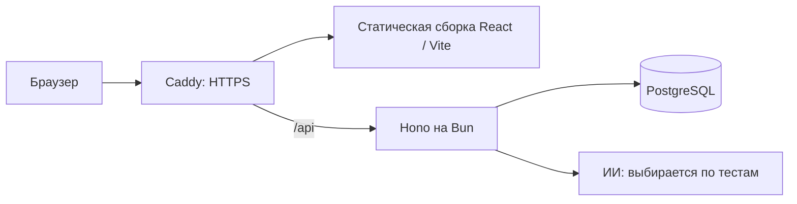

# Сравнение вариантов и принятый стек

Статус: сравнение завершено выбором пользователя 20 октября 2026 года — Hono + Bun, PostgreSQL, без брокера на старте. Действующая спецификация — [ARCHITECTURE.md](ARCHITECTURE.md), pins и фактические проверки — [STACK-COMPATIBILITY.md](STACK-COMPATIBILITY.md). Ниже сохранены основания и рассмотренные альтернативы. RPO/RTO Q36 остаются открытыми; приложение не реализовано.

## Критерии выбора

Стек должен поддерживать интерактивную сборку предложений, проверяемые серверные операции повторения, личные данные и понятное сопровождение на одном VPS. Качество оценивается по корректности этих сценариев, воспроизводимым релизам и возможности восстановить прогресс. Популярность или необычность названия технологии не являются самостоятельным критерием.

| Вариант | Что даёт этому проекту | Цена решения |
| --- | --- | --- |
| React + TypeScript + Vite, NestJS | Клиентский интерфейс; один основной язык; явная структура серверных модулей; официальный OpenAPI-инструмент Nest | Две сборки; routing и получение серверных данных на клиенте выбираются отдельно; подключение авторизации требует проверки |
| Vue 3 + TypeScript + Vite, NestJS | Та же схема размещения; SFC и Composition API как другой способ организации интерфейса | Те же серверные обязанности; преимущества для нашего редактора нужно оценивать по реализации, а не по числу пользователей |
| React/Vue + Django | Встроенные ORM, миграции, пользователи, cookie-сессии и административный интерфейс | Python и TypeScript; HTTP-контракт между языками; серверная библиотека расписания выбирается заново |
| React/Vue + Fastify напрямую | Готовые HTTP-механизмы, hooks/plugins и JSON Schema validation/serialization с меньшим числом framework-слоёв | Соглашения серверных модулей потребуется задать проектом |
| React/Vue + Hono на Node.js или Bun | Fetch-интерфейс, middleware, RPC; официальный пример Zod/OpenAPI, документированная интеграция Better Auth | Структуру предметных модулей задаёт проект; Bun выбирается отдельно от Hono и проверяется с конкретными зависимостями |
| React/Vue + Elysia | Схемы проверки, OpenAPI и типизированный клиент Eden; ориентация на Bun с адаптерами других runtime | Более тесная связь с framework/client; преимущества для учебного API не измерены |
| Next.js | Интерфейс и серверные обработчики в одном framework, меньше отдельных частей сборки | Потребность в SSR не следует из текущих требований; размещение учебной логики всё равно нужно спроектировать |

Свойства проверены по [официальным источникам](sources.md#проверка-вариантов-архитектуры). Оценка пригодности и цены — инженерные выводы, а не результаты нагрузочного сравнения.

## Решение Q34 после изучения Hono и Bun

Пользователь выбрал Hono + Bun; Node.js/NestJS не являются текущим backend. В рамках запроса конкретных инструментов выбраны React + TypeScript + Vite для браузерного приложения. Совместимость проверена отдельным пакетом, а необходимость Linux/VPS-проверок сохранена. Подробные свойства и границы очередей — в [исследовании](RUNTIME-AND-JOBS.md).

Один репозиторий и согласованный релиз. Все серверные предметные модули исполняются в одном backend-процессе — это модульный монолит. Браузер работает с тем же origin: `/api` направляется в backend, статические ресурсы обслуживает reverse proxy. Отдельный Node-процесс для интерфейса в production в этой схеме не нужен.

Hono может использовать явные схемы через `@hono/zod-openapi`; Nest имеет официальный OpenAPI-модуль. Наличие описания само по себе не обеспечивает авторизацию или проверку каждого исходящего ответа. Структуру операций повторения, владение данными и жизненный цикл запросов определяет проект. Выбор runtime не обосновывается рекламным HTTP-бенчмарком.

Vue остаётся способной выполнить те же требования рассмотренной альтернативой. Конкретный текущий frontend-набор и lockfile уже подготовлены; смена стека требует обновления спецификации и повторной проверки.

## Решение Q35 о БД

Пользователь выбрал PostgreSQL: независимые параллельные записи, блокировка отдельных строк и удобный путь к нескольким backend-процессам при реальной необходимости. Цена — отдельная служба, настройка соединений и обслуживания, память и резервное копирование. Это осознанный выбор схемы эксплуатации, а не утверждение, что 100 аккаунтов требуют PostgreSQL.

SQLite поддерживает настоящие транзакции и остаётся технически допустимым вариантом одного сервера. WAL допускает читателей одновременно с одним writer; несколько одновременных writers не появляются. Для PostgreSQL default Read Committed также недостаточно просто обернуть произвольный код в `BEGIN`: понадобятся ограничения уникальности и условное обновление версии либо блокировка строки. Serializable требует обработки повторов при конфликте сериализации.

Для обеих БД обязательна атомарная операция: проверить владельца, отличить повторную доставку от новой попытки, проверить версию повторяемого объекта, записать историю и применимое расписание, подтвердить commit. Долгий запрос к ИИ выполняется за пределами write-транзакции. Точный контракт предъявления и попытки рассматривается после выбора основных частей стека.

## Требования к production-реализации

- **Предметные модули.** Учётные записи и приглашения; учебный корпус; учебная практика и повторения; личные слова; свободный разбор. У каждого — небольшой явный интерфейс для вызывающего кода; транспортные обработчики используют эти операции. Расчёт расписания и проверка подготовленного ответа тестируются без HTTP.
- **Состояние интерфейса.** Сборка предложения хранит экземпляры элементов, а не только словарные ID. Переключение написания меняет отображение. Неподтверждённый результат сохраняется до подтверждения сервера. Поздний разбор сравнивается с версией редактируемой фразы.
- **Доверенные данные.** Сервер проверяет входные схемы, сессию и владельца. Тип TypeScript или OpenAPI-декоратор не заменяет runtime-проверку. Вызов ИИ имеет таймаут, ограничение частоты и проверку формы ответа; его отказ не блокирует сохранение обычного повторения.
- **Контракт.** HTTP/JSON с документированными входами, результатами и кодами ошибок; OpenAPI и клиент проверяются на совместимость. Конкретные auth/ORM/router/cache выбраны и проверены по матрице; прикладные операции ещё предстоит реализовать.
- **Релиз.** Предложены GitHub Actions для проверок и Linux-сборки, Docker Compose для одного VPS и Caddy для HTTPS и маршрутизации. Образы идентифицируются версией, секреты и БД живут вне заменяемой сборки. Миграции выполняются управляемым отдельным шагом. Откат приложения проверяется вместе с совместимостью схемы БД; автоматический откат схемы не предполагается.
- **Диагностика.** Структурированные логи с request ID, коды ошибок, задержки обычного API и ИИ отдельно; health/readiness, контроль памяти, диска и давности последней успешной резервной копии. Пароли, сессии и одноразовые токены не записываются в логи; учебные предложения по умолчанию также не нужны для диагностики.
- **Проверки.** Unit-проверки правил и расписания; интеграционные проверки на выбранной настоящей БД для конкурентных ответов и изоляции пользователей; Playwright для ключевых пользовательских сценариев, клавиатуры и мобильного интерфейса. Успешная проверка только с mock-хранилищем не подтверждает корректность транзакций.

У каждого production-инструмента должна быть конкретная задача. В исходную поставку предложены один backend, одна БД и reverse proxy. В текущих потоках оснований для отдельного брокера не выявлено: повторение сохраняется транзакцией, а live-разбор привязан к актуальной фразе. Условия появления долговечных заданий, PostgreSQL-очереди или внешнего брокера описаны в [отдельном сравнении](RUNTIME-AND-JOBS.md). Готовность 1 vCPU / 2 GB к выбранному составу проверяется измерениями; сборка выполняется вне VPS. Обещания непрерывной доступности одного сервера нет.

## Восстановление для Q36

Предложенные начальные цели: потеря не более часа подтверждённых данных (RPO ≤ 1 час), восстановление в пределах четырёх часов после обнаружения аварии (RTO ≤ 4 часа). Периодические копии сохраняются за пределами исходного VPS, восстановление проверяется на отдельной копии. Цели пока не приняты и не измерены; место хранения, сроки хранения, оповещение и порядок доступа к копии определяются после ответа. Платное хранилище не подключалось.

## Текущее дерево решений

- **Q34: контур, framework и runtime.** Hono + Bun приняты; React/Vite, маршрутизация, cache и auth выбраны под запрос конкретного набора → реализация предметных контрактов и Linux-проверка.
- **Q35: БД.** PostgreSQL принят; stable ORM/драйвер и миграции проверены локально → реализация review и проверка целевого Linux image.
- **Q36: восстановление.** Предложены RPO ≤ 1 час и RTO ≤ 4 часа → затем способ, место и срок хранения копий, оповещение и проверка восстановления.

Q34–Q35 и отсутствие брокера приняты; Q36 ещё не принят. Продуктовые решения Q1–Q33 остаются в силе. Неопределённая политика восстановления учитывается отдельно и не отменяет выбранный стек.
