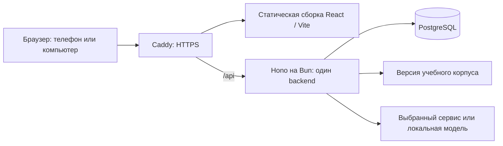

# Архитектура приложения

Статус: Hono + Bun, PostgreSQL и отсутствие брокера на старте приняты пользователем 20 октября 2026 года. Остальные инструменты выбраны под эту основу и закреплены в [проверочном package.json](../verification/stack/package.json), [bun.lock](../verification/stack/bun.lock) и [toolchain.json](../deployment/toolchain.json). Исходная матрица совместимости — в [STACK-COMPATIBILITY.md](STACK-COMPATIBILITY.md); реализация, локальные проверки и их ограничения — в [VERIFICATION.md](VERIFICATION.md). Linux/VPS и качество внешнего ИИ отдельно не подтверждены.

## Подтверждённые основания

Приложению нужны общий прогресс между устройствами, до 100 аккаунтов / 10 одновременно занимающихся, заранее подготовленный расширяемый корпус, независимые расписания грамматических навыков, двух текстовых направлений словарных карточек и аудирования, проверяемые упражнения и свободный разбор. Первая версия работает онлайн с сохранением результатов при кратких сбоях; доступ по приглашениям, данные личные.

## Схема размещения

Один репозиторий и согласованный релиз; frontend и API работают с одним origin. Caddy обслуживает статическую сборку и направляет `/api` в Bun. Отдельного frontend-сервера в production нет. Backend, PostgreSQL и Caddy размещаются на исходном VPS; Redis, брокер и worker на старте отсутствуют. Причины — [ADR-0002](adr/0002-host-application-and-progress-together.md), [ADR-0004](adr/0004-hono-on-bun.md) и [ADR-0005](adr/0005-postgresql-without-message-broker.md).

## Закреплённый технический стек

| Задача | Инструмент и версия |
| --- | --- |
| Runtime / язык | Bun 1.4.3; TypeScript 7.0.2; Node 24.22.0 только для браузерных инструментов CI |
| Frontend | React / React DOM 19.3.1, Vite 8.3.4, plugin-react 6.1.2; SPA |
| Маршруты / серверные данные | react-router 8.5.0 в declarative mode; TanStack Query 5.104.5 |
| Сборка предложений | @dnd-kit/react 0.5.1, включая sortable; действия нажатием и клавиатурой реализуются и проверяются приложением |
| API / контракт | Hono 4.13.13; @hono/zod-openapi 1.6.3 и Zod 4.6.7; HTTP/JSON, Hono `hc` для типизированного собственного клиента |
| Учётные записи и сессии | Better Auth 1.7.11; серверные cookie-сессии в PostgreSQL, встроенный re-export Drizzle adapter |
| Пользовательские данные | PostgreSQL 18.6; Drizzle ORM 0.45.4 через встроенный Bun.SQL / `drizzle-orm/bun-sql` |
| Миграции | Drizzle Kit 0.31.11; сгенерированный SQL проверяется и хранится с релизом |
| Расписание | ts-fsrs 5.4.2; серверный расчёт отдельных состояний слов и навыков |
| Логи / проверки | Pino 10.4.0 в stdout без worker transport; Bun test; Playwright 1.64.1 |
| Выпуск | Docker Engine 29.9.1, Compose 5.6.0, Caddy 2.11.7; GitHub Actions с закреплёнными action SHA |
| Контент | Версионируемые файлы корпуса со стабильными идентификаторами, источниками и статусами проверки |
| Маскот | Подготовленные PNG, смена состояний и CSS-движение с учётом уменьшения анимации |
| ИИ | Выбор по отдельному сравнению качества; вызов только через сервер приложения |

Первичные источники — в [реестре](sources.md); точные npm-pins и транзитивные версии — в проверочном manifest/lockfile. Установка использует isolated linker из `bunfig.toml`: это устранило конфликт необязательного esbuild peer Vite с транзитивной версией инструментов миграций. Полный каталог `node_modules/.bun` и относительные ссылки сохраняются при сборке Linux-образа. Связка проверена локально по отдельной матрице; это не нагрузочное испытание.

PostgreSQL размещается вне заменяемого образа. Для PostgreSQL 18 persistent volume монтируется в `/var/lib/postgresql`, значение PGDATA — `/var/lib/postgresql/18/docker`. Обновление контейнера сохраняет данные; major-upgrade БД является отдельной операцией. Резервная копия считается пригодной после проверки восстановления.

## Фактическая исходная инфраструктура

По приложенному пользователем снимку: Ubuntu 22.04, 1 vCPU (3,5 GHz), 2 GB DDR4 RAM, 20 GB NVMe, Амстердам / Нидерланды; GPU отсутствует. Свободная память, диск, архитектура CPU и существующие службы не проверялись.

Базовый вариант запускает API, PostgreSQL и reverse proxy. Локальная Qwen3-8B не входит в исходный серверный состав: опубликованный артефакт около 5,2 GB не является замером RAM, но интерактивное выполнение на VPS с 2 GB не принимается как рабочая предпосылка. Локальное моделирование испытывается на другом или расширенном оборудовании; размер расширения заранее не выбран.

Production-сборку выполнять вне VPS для его целевой Linux-платформы. В поставку входят Vite `dist`, Bun API с production-зависимостями, корпус и проверенные миграции. Сборка вне сервера сокращает пиковую нагрузку, но не доказывает достаточность 2 GB для runtime. Увеличение ресурсов обосновывается замерами при 10 одновременно занимающихся. Подробности — в [DEPLOYMENT.md](DEPLOYMENT.md).

## Модули и HTTP-контракт

Backend состоит из модулей учётных записей, корпуса, практики/повторений, личных слов и свободного разбора. Каждый предоставляет небольшие предметные операции; HTTP-маршруты проверяют схемы, устанавливают пользователя и вызывают их. Drizzle-запросы и транзакции сосредоточены рядом с операцией, которая обеспечивает инвариант. Проверка упражнения и расчёт FSRS доступны тестам без HTTP.

Общие Zod-схемы и `@hono/zod-openapi` описывают входы, результаты и ошибки. OpenAPI экспортируется из релиза; собственный TypeScript-клиент использует `hc` и типы маршрутов. Глобальные ошибки и ошибки middleware включаются в контракт явно. ORM-модели не передаются в frontend. Ответ внешнего ИИ отдельно проверяется Zod до использования.

Локальное состояние редактора хранится в React reducer; TanStack Query отвечает за серверные данные. Мутация повторения считается сохранённой после commit и подтверждения сервера, а не после оптимистичного изменения cache. Одноразовые неполучившие подтверждение попытки сохраняются на устройстве до сверки. Стили — CSS Modules и общие CSS-токены, короткие движения — CSS с `prefers-reduced-motion`; отдельный UI-kit или animation engine стартовой версии не требуется.

## Жизненный цикл свободного разбора

Технические параметры: согласованная пауза редактирования 700 ms, deadline внешнего ИИ 15 s, Bun HTTP idle timeout 30 s, proxy timeout ожидания заголовков 35 s. Это конфигурация, а не измеренный SLA; целевой p95 полного разбора ≤ 10 s сохраняется. Идентификатор/версия фразы и ограничения материала передаются с запросом; поздний результат не заменяет текущий.

Один backend ограничивает частоту и число одновременных обращений до вызова провайдера; параметры согласуются с его фактической квотой. Отмена передаётся провайдеру, если поддерживается, и не объявляется гарантией прекращения оплачиваемых вычислений. При рестарте незавершённый разбор может потребовать повтора. Подтверждённый прогресс хранится независимо от него; очередь «на каждую фразу» отсутствует.

При SIGTERM backend прекращает приём новой работы, дожидается активных операций в пределах установленного лимита и закрывает SQL pool. Внешний ИИ никогда не удерживает открытую write-транзакцию. Расчёт ближайших повторений выполняется запросом к сохранённым due timestamps; задача по таймеру на каждую карточку не создаётся.

## Границы данных

| Данные | Смысл |
| --- | --- |
| Учебный корпус | Общие учебники, уроки, Can-do, слова, применения конструкций, объяснения, проверенные примеры и допустимые ответы |
| Настройки ученика | Доступный материал, фокус тренировки и независимые ограничения категорий свободного режима |
| Повторяемый грамматический навык | Применение конструкции с собственным состоянием расписания и историей ответов |
| Словарная карточка | Отдельное расписание для пары «слово + направление»: `ja-ru`, `ru-ja`, `listening`; аудио использует тот же идентификатор слова/смысла, но самостоятельное состояние |
| Личный список слов | Частный материал владельца; обмен списками не входит в текущий объём |
| Разбор предложения | Перевод, грамматическая допустимость, естественность, объяснение и явно отмеченная неопределённость |

Идентификаторы учебников, уроков, слов и навыков должны оставаться стабильными при добавлении контента. Изменение примера не должно создавать заново освоенный навык. Идентичные номера уроков разных учебников не должны смешивать прогресс.

У каждой привязки к источнику сохраняются книга/часть и урок: первые два урока Katsudoo и Rikai различаются по содержанию. Общая нумерация не означает одинаковое наполнение двух книг.

## Три варианта отображения слова

Хранить подготовленную словоформу и чтение с разметкой соответствия: обычное написание, запись каной и последовательность фрагментов, где у кандзи при необходимости есть чтение. Пример HTML-отображения: `<ruby>家族<rt>かぞく</rt></ruby>`; для слова без кандзи дополнительная разметка не требуется.

Кана показывает подготовленное чтение; вариант с фуриганой выводит чтения над кандзи; вариант без фуриганы сохраняет обычное написание, включая окуригану и кану. Не использовать автоматическую посимвольную транслитерацию как источник истины. [Примеры данных](../materials/examples/orthography.json) иллюстрируют контракт, но не являются полным словарём курса.

Согласовано: настройка меняет представление во всём приложении, но не идентификатор слова и не состояние повторения; по умолчанию — кандзи с фуриганой. Каноническое предложение и его оценка не меняются от отображения; фуригана не считается подсказкой к решению.

## Предлагаемые правила проверки

- Режим обучения использует подготовленное задание и допустимые ответы; свободный ответ ИИ не заменяет проверку такого упражнения.
- Выбор тем не подменяет доступный словарь. Доступ к словам и частицам проверяется независимо.
- Грамматическая ошибка, изменение смысла, неестественность, незавершённая фраза и материал вне выбранных уроков должны различаться в модели ответа; точные категории ещё согласуются.
- Перестановка элементов немедленно меняет видимое предложение. Внешний разбор запускается после короткой паузы, длительность которой уточняется тестами; устаревший ответ не должен отображаться как разбор новой фразы.
- Исчерпание бесплатной квоты не запускает платный запрос. Пользователь видит состояние недоступности; проверенные упражнения продолжают существовать независимо от сервиса ИИ.

## Повторения

Используется ts-fsrs 5.4.2; выполнение под Bun подтверждено probe. Для навыков и слов нужны отдельные состояния и записи результатов. В первой реализации словарь использует Again/Hard/Good/Easy. Новое согласованное взаимодействие заменяет четыре пользовательских действия двумя — «помню» и «повторить», сохраняя прежнюю историю. Результат конструкции записывается только при переходе к следующему заданию по финальному ответу на исходное целевое задание; промежуточные ответы и разборы не меняют расписание, исследование иной фразы остаётся без оценки. Сопоставление результата оценке выполняется в модуле практики. Общая очередь и чистая предварительная проверка реализованы; фактическое покрытие — в VERIFICATION.

Начальные лимиты — 5 новых слов и 2 новых навыка в день, назначенные повторения идут первыми. Слово учитывается один раз при вводе независимо от двух текстовых направлений и аудирования; состояния трёх направлений независимы. Длительность 10–15 минут — ориентир, а не принудительное завершение задания по таймеру.

## Аудирование

Аудиокарточка предъявляет слово или короткую фразу без видимого текста; после раскрытия показывает японский текст и русский смысл. В новом согласованном взаимодействии оценка и переход выполняются двумя действиями «помню»/«повторить», как у текстовых карточек; прежние четыре элемента управления заменены. Результат хранится для направления `listening` отдельно от `ja-ru` и `ru-ja`; смена написания и успешная текстовая карточка не меняют аудиорасписание. Микрофон и распознавание речи не нужны.

Для одинакового воспроизведения на устройствах готовятся статические японские TTS-файлы AAC/M4A; `Word.audioUrl` указывает на соответствующий ресурс; необязательный `Word.audioText` задаёт произношение изолированной частицы отдельно от её правильного написания в `kana`. Источник генерации и проверка качества учитываются отдельно: синтезированная речь не объявляется проверенной человеком. Бесплатный японский browser speech fallback допустим только при наличии японского голоса; отсутствие звука отображается явно и не записывает повторение. Автоматического платного TTS нет.

## Общий контракт реализации

Каталоги: `src/server`, `src/client`, `src/shared`, `tests`. DTO находятся в [src/shared/types.ts](../src/shared/types.ts), корпус — в `materials/course.json`, загрузка и проверка корпуса — в `src/shared/course.ts`. Идентификатор `Word` обозначает слово/значение, `WordForm` — конкретную форму; токен упражнения имеет собственный идентификатор экземпляра и ссылается на форму. Все 18 уроков сохраняют источники Katsudoo/Rikai и явные статусы готовности; L4 — внутренний тест, а не сокращение поставки.

| HTTP | Результат / назначение |
| --- | --- |
| `GET /api/course` | `Course` |
| `GET /api/settings`, `PUT /api/settings` | `LearnerSettings` |
| `GET /api/progress` | `Progress` |
| `GET /api/reviews?mode=...` | `ReviewQueue`, режимы `ja-ru`, `ru-ja`, `listening`, `grammar` |
| `POST /api/reviews` | `ReviewSubmission` → `ReviewResult`; UUID попытки и версия защищают от дублирования и конкурирующих ответов |
| `GET /api/lists`, `POST /api/lists` | Личные списки; создание из имени и вставленного текста |
| `PATCH /api/lists/:listId/words/:wordId` | Изменение личного слова с проверкой владельца |
| `POST /api/analyze` | `AnalysisRequest` → `AnalysisResult`; версия текста возвращается для защиты от устаревшего ответа |

У грамматического ответа сервер проверяет порядок экземпляров и выбранные формы по подготовленному заданию; пользовательская оценка не подменяет эту проверку. Внешний разбор не определяет результат учебного упражнения.

## Пользователи и синхронизация

Подтверждены приглашения, email/пароль, ручная выдача одноразовых ссылок приглашения и восстановления, частные прогресс и словари, до 10 одновременно занимающихся и работа онлайн. Сервер хранит актуальное расписание; уникальный идентификатор попытки защищает от повторной отправки, а устройство сохраняет неподтверждённый результат до ответа сервера.

Разные ответы на одну предъявленную версию карточки разрешаются по правилу первого принятого ответа: он обновляет расписание, последующая попытка сохраняется как дополнительная практика. Уникальность попытки и актуальность версии карточки проверяются в одной транзакции; повтор запроса возвращает уже сохранённый результат. Это не требует полноценного автономного курса или отдельной системы событий.

Приглашение — собственная небольшая логика приложения поверх авторизации: одноразовый токен, срок действия и привязка к адресату. Автоматическая отправка email не требуется: административный раздел выдаёт ссылку для ручной передачи. Восстановление отзывает прежние сессии согласно выбранной политике безопасности; готовность библиотеки не заменяет проверки всего сценария.

Прямой Better Auth signup в production проходит обязательную проверку приглашения; приватные операции проверяют владельца на сервере. Compatibility-probe проверяет базовые signup/sign-in/session без политики приглашений и не является готовым production auth-модулем. Требование закрытой регистрации остаётся отдельным критерием приёмки приложения.

Проверка владельца данных выполняется сервером. Секреты внешнего ИИ не передаются в клиентскую сборку. Локальная модель, если будет выбрана, не публикуется в интернет без сервера приложения с проверкой доступа.

## Визуальные материалы

PNG кота, manifest и демонстрация находятся в `assets/mascot/`. Анимация может использовать смену состояний и небольшие преобразования без отдельного игрового движка. Уменьшение движения и неподвижный текст упражнений входят в рекомендации по доступности.

## Границы реализации и испытаний

1. Основной backend-стек принят; RPO/RTO из Q36 пока остаются предложением, их нельзя объявлять утверждёнными.
2. Проверка кандидатов ИИ по [плану оценки](AI-EVALUATION.md), включая согласованные пороги и доступность реального аккаунта. Страна сервера сама по себе не определяет доступность облачного сервиса для аккаунта.
3. Полнота и лингвистическая проверка корпуса: структурная карта не подменяет словарь и задания.
4. Реальные испытания доступа, синхронизации, восстановления данных, мобильного интерфейса и нагрузки по [ACCEPTANCE.md](ACCEPTANCE.md).
