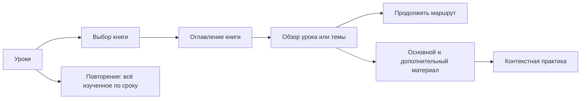

# Добавление Marugoto A2-1, A2-2 и A2/B1

Окончательный план для исполнения в отдельном чате. Дата: 6 ноября 2026. Рабочий каталог: корень репозитория. Статус: готов к запуску; Q1–Q5 подтверждены пользователем, открытых продуктовых развилок нет. Реализация приложения в этом чате не выполняется. Начать с P0, не запрашивая повторного подтверждения принятых решений.

## Результат и границы

Добавить три полноценных учебника рядом с действующим A1: Elementary 1 A2 — 18 уроков, Elementary 2 A2 — 18 уроков, Pre-Intermediate A2/B1 — 9 тем. Итог — 45 новых учебных единиц с маршрутами, основным и дополнительным материалом, связанной практикой и общим повторением. Два пилотных урока, прототип выбора книги или один импорт словаря не являются завершением всего плана.

Последовательность выпуска: A2-1 → A2-2 → A2/B1. Ученик свободно открывает любой опубликованный урок/тему; прохождение предыдущего уровня не требуется. Существующие идентификаторы, изученность, ответы и расписания A1 сохраняются. Новый пользовательский импорт Anki, локальные личные наборы, новый движок повторения и редизайн всего приложения в этот объём не входят.

Материал готовится как собственное русскоязычное сопровождение официальной программы: объяснения, примеры, задания и озвучка с проверенными источниками. Наличие бесплатных файлов Marugoto не разрешает их массовую перепубликацию. Полная электронная копия книг не является результатом этого плана.

## Решения пользователя и исходные ограничения

| Вопрос | Решение | Статус |
| --- | --- | --- |
| Q1: уровни и объём | Все три учебника, полноценные уроки и дополнительный словарь, поэтапный выпуск | Подтверждено |
| Q2: доступ | Свободный выбор книги и урока; выбор не означает «уже изучено» | Подтверждено |
| Q3: навигация | Выбор книги внутри «Уроков», место продолжения в каждой книге; повторение общее | Подтверждено |
| Q4: новое значение известного слова | Одна словарная запись; новое значение имеет отдельное изучение/повторение, старые результаты сохраняются | Подтверждено |
| Q5: содержательные задания | Чтение/аудирование, вопросы по содержанию, собственный ответ с образцом и самооценкой; без автоматической проверки произвольной речи/сочинений | Подтверждено |

Окончательное подтверждение Q4–Q5: «Да, подтверждаю Q4 и Q5. Зафиксируй оба решения и подготовь окончательный план для запуска в отдельном чате». Решения закреплены в [ADR-0021](adr/0021-share-words-and-track-meanings.md) и [ADR-0022](adr/0022-distinguish-self-assessed-production.md); навигация — в [ADR-0020](adr/0020-keep-books-separate-and-learning-shared.md).

Ранее принятые правила не переоткрывать: общий материал публикует редактор; дополнительный словарь не меняет обязательный маршрут; импорт не переносит историю Anki и не означает изученность; одинаковые слова не дублируются по урокам; другие значения не становятся отдельными словами автоматически. Отметка «Уже проходил» — отдельное личное действие по [ADR-0017](adr/0017-recognize-prior-learning.md). В документах она согласована, но на дату исследования её реализация ещё не подтверждена: зависимость необходимо проверить в начале исполнения.

Применены ponytail, grill-with-docs → grilling/domain-modeling, router → pixijs-rendering/game-ui-ux. Council использован для продуктовой развилки навигации; [позиции и возражения](research/marugoto-a2-council-2026-11-06.md) сохранены отдельно. Совет единогласно поддержал локальный выбор книги. Сильнейшее возражение — фильтр учебника не следует автоматически размножать по всем разделам.

## Что проверено в исходниках

Срез исследования: ветка `prototype/pixi-ui-lab`, HEAD `0f0b4ac`, рабочая копия с существующими изменениями. Перед исполнением проверить актуальное состояние; не выполнять reset/clean и не откатывать чужие изменения ради этого плана.

- Основная точка входа `index.html` использует `src/client/canvas/boot.ts` → `connected-album.ts`. PixiJS закреплён на 8.22.0. `legacy.html` — совместимый React для отката, не отдельный продукт. Canvas перенос уже интегрирован в root sources; старые лабораторные прототипы не являются местом новой реализации. Действующий renderer production по одному checkout не установлен.
- `Course` содержит один плоский массив уроков и общие слова/формы/навыки. У `Lesson` нет принадлежности книге; Can-do — числа без пространства учебника. `Word.meaningRu` — строка, отдельного прогресса значений пока нет.
- `validateCourse` требует 18 уроков и Can-do 1–50; `validateLearning(..., true)` — 18 маршрутов. `loadCourse` читает `materials/course.json` и только `materials/learning/lesson-XX.json`.
- `/api/course` и `/api/bootstrap` возвращают один опубликованный набор, `/api/learning/:lessonId` уже адресует урок устойчивым ID. Повторение `mode=mixed` использует существующие типы и общие расписания. Поиск/выбор книги на сервере ещё не реализованы.
- Публикации неизменяемые, со своим хешем; активна одна публикация. Клиентские попытки закреплены за владельцем, публикацией и версией. Сохранение и анимация не заменяют друг друга.
- Текущие ограничения упаковки: JSON входного bundle до 12 MiB, до 20 000 медиафайлов, 500 MiB суммарно и 100 MiB на файл. На диске в проверенном срезе `course.json` + 18 route JSON занимали 3 292 587 байт; каталоги audio/word-illustrations/counters — 67 692 892 байта / 3 845 файлов. Это не размеры API-ответа или будущей публикации и не замер производительности.

## Интерфейс

Полная спецификация экранов, макеты и состояния: [marugoto-a2-interface.md](marugoto-a2-interface.md). Она является частью плана, а не необязательной иллюстрацией.

Основной путь:



Выбор книги действует внутри «Уроков». В оглавлении есть заметный переключатель и прямое продолжение; у A2/B1 девять тем. Обзор объединяет маршрут, объяснения, словарь, диалоги и практику. Готовность содержания («полный урок», «только словарь», «готовится») отделена от личного прогресса. Общая очередь не меняется при выборе другой книги. В первом объёме не требуется новый фильтр учебника в каждом разделе: общий поиск и практика из конкретного урока покрывают основные сценарии.

Сохраняются бумажная композиция, текущие декорации, desktop-разворот и мобильный одинарный лист. Доступность, фокус, измерение текста, страницы длинных списков, фуригана и нативные служебные мосты переиспользуются. Не переносить эту функцию в новый видимый HTML-интерфейс поверх Canvas. Совместимый React поддерживает тот же контракт, новые учебники и задания в достаточном для продолжения работы объёме.

## Модель содержания и совместимость

Это предлагаемый технический способ выполнить принятые правила. Исполнитель может упростить форму хранения при сохранении всех гарантий и тестов; новые сервисы, отдельные БД на учебник и универсальный CMS/редактор не требуются.

| Понятие | Требуемая связь и правило |
| --- | --- |
| Учебник | Устойчивый ID, название, уровень, порядок, тип основной единицы «урок»/«тема» и ожидаемая структура |
| Урок/тема | Один учебник, устойчивый ID, локальный номер, порядок, заголовок, доступные материалы; одинаковые номера в разных книгах допустимы |
| Can-do | Идентичность с контекстом учебника; число 1 в A1 и A2 — разные цели |
| Слово/форма | Общая запись и ID; связи со всеми нужными уроками, без копий на книгу |
| Учебное значение | Ссылка на общее слово, конкретный смысл и контекст, связи с уроками; самостоятельное изучение и повторение по Q4 |
| Конструкция | Общий навык там, где смысл обучения действительно одинаков; новое употребление одной формы не объединять автоматически |
| Маршрут | Версионированные цели и части конкретной учебной единицы, устойчивые ID шагов |
| Доступность | Редакционная готовность содержания, независимая от личного учебного состояния |
| Публикация | Один согласованный снимок библиотеки с несколькими книгами и общими материалами; сохраняется существующий атомарный механизм |

Сохранить все существующие ID A1, включая слова с префиксом `marugoto.starter-a1`: такой префикс не запрещает ссылаться на запись из A2. Новые уроки получают пространство своей книги, например `marugoto.elementary1-a2.lesson.01` и `marugoto.pre-intermediate-a2b1.topic.01`. Это примеры канонического соглашения: зафиксировать один вариант до создания контента и проверить коллизии.

Числа Can-do могут оставаться локальными в редакционных источниках; глобальные ссылки, фильтры и прогресс должны включать книгу. Прежние `focusCanDoIds` трактуются как A1, а не применяются ко всем книгам с тем же номером. Не ограничиваться удалением проверок «18/50»: валидировать ожидаемый состав каждой книги, уникальность ссылок и готовность каждой публикуемой единицы. Для A2/B1 источнику нужна честная категория объединённой книги, а не фиктивная пометка Katsudoo/Rikai.

Расширить публикационный формат с явной версией и поддержкой чтения старого формата. Хеш старого bundle проверять на его исходном содержимом до адаптации; не переписывать сохранённые публикации. Старые попытки и незавершённые маршруты обрабатываются по прежней публикации/версии. Разделение исходников на папки учебников не требует отдельных серверов публикации; общий словарь собирается один раз. Не копировать целую запись слова с несовпадающими `lessonIds` в каждый route: учитывать проверку конфликтующих `authored`-записей в `withLearningMaterial`.

### Совместимость значений — принято в Q4

Одинаковое значение одного слова во всех книгах использует одну учебную цель и расписание на направление. Новое значение создаёт новую учебную цель, но не новую словарную запись. Упражнение обязано давать контекст, исключающий несколько правильных значений, и принимать смысловые эквиваленты по существующим правилам проверки.

Старые `review_states`, `review_attempts`, `study_progress`, ID карточек и due сохраняются без массового пересоздания. Прежняя цель по `wordId` остаётся совместимым представлением опубликованного содержания A1; новые цели значений добавляются отдельно. История старых ответов не позволяет достоверно разнести знание по вновь выделенным смыслам, поэтому запрещено задним числом создавать для них фиктивный прогресс. Уже опубликованные значения A1 не следует автоматически дробить только ради новой схемы. При показе наследованного состояния не заявлять, что каждое значение проверялось отдельно.

Новый общий смысл, увиденный в другом уроке, не создаёт вторую карточку. Действительно новый смысл не становится изученным через знакомое написание. Аналогично словоформа не равна новому слову, а омонимы не сливаются по кане. Повторный запуск сопоставления должен давать те же ID и нулевой повторный импорт.

Провести различие между ID словарной записи и ID изучаемого значения через все потребители: варианты ответа, `studySpec`, `introducedMaterial`, доступность материалов конструктора/счёта, справочник и «Уже проходил». Новые ID учебных целей нельзя механически трактовать как `wordId`. При поэлементной отметке охват — выбранное значение; массовая отметка охватывает только основные значения и конструкции данного урока. Другие значения слова не отмечаются автоматически. Прежние payload с `choiceWordId` и старые очереди остаются совместимыми с прежней публикацией.

### Новые задания — принято в Q5

Расширить существующую модель маршрута только нужными видами задания: понимание текста/диалога с вопросами и собственный ответ с образцом/критериями. Чтение и аудирование могут использовать общий материал ситуации с разным способом предъявления; не строить универсальный движок произвольных интерактивных блоков.

Для проверяемых вопросов сервер определяет правильность и сохраняет ответ идемпотентно. Для свободного ответа сохраняются выполнение и самооценка, явно отличающиеся от автоматической оценки. Факт просмотра текста, раскрытия образца или воспроизведения аудио не является успешным ответом. Свободная речь не записывается и не отправляется внешней модели. Новый текст целиком не становится новой карточкой FSRS; изучение и повторение конкретной лексики/конструкций сохраняют существующие правила.

При обычном прохождении новой темы её обязательные задания на понимание и собственный ответ входят в завершение маршрута: одни изученные слова не означают выполнения этих шагов. Отметка целой темы «Уже проходил» остаётся отдельным признанием прежнего изучения, без выдуманных ответов или успешной самооценки. Сохранённое выполнение задания и уверенность ученика различаются; результат самооценки не обозначать «проверено системой» и не выдавать за достижение уровня CEFR.

Восстановление после reload, переходы между фрагментами, возврат к условию и работа без сети после загрузки не теряют уже принятый ответ. Не обещать запуск всего приложения офлайн. Старые маршруты A1 не получают новые обязательные шаги ради поддержки новых типов.

## Источники и подготовка содержания

Проверенный перечень: [аудит материалов](research/marugoto-a2-materials-2026-11-06.md). Основные каталоги: [A2-1 Katsudoo](https://marugoto.jpf.go.jp/en/download/elementary1_a/), [A2-1 Rikai](https://marugoto.jpf.go.jp/en/download/elementary1_c/), [A2-2 Katsudoo](https://marugoto.jpf.go.jp/en/download/elementary2_a/), [A2-2 Rikai](https://marugoto.jpf.go.jp/en/download/elementary2_c/), [A2/B1](https://marugoto.jpf.go.jp/en/download/pre_intermediate/).

| Книга | Полнота структуры для проверки | Грамматические пункты источника | Наш Anki-набор |
| --- | --- | --- | --- |
| A2-1 | 18 уроков / 9 тем / 53 Can-do | 75 | 592 записи |
| A2-2 | 18 уроков / 9 тем / 49 Can-do | 78 | 737 записей |
| A2/B1 | 9 тем / 44 Can-do | 43 | 715 записей |

Всего 146 новых целей и 196 строк официальной таблицы грамматики. Эти числа не означают 196 неповторяющихся навыков или готовых упражнений. Отсутствие грамматического пункта допустимо только с явной причиной в карте покрытия, а не из-за потери строки при импорте.

Переведённые файлы преподавателя: `anki-teacher-ru-2026-11-06/Marugoto_JP-EN-RU.json` и `.csv`; APKG — `Marugoto_A1-A2-B1_JP-EN-RU.apkg`. Исходная AnkiWeb-колода — <https://ankiweb.net/shared/info/1959736586>. Не считать её официальным полным словарём: в ней удалены повторы. Русский перевод подготовлен ИИ и требует сверки; официальный русский словарь есть для всех пяти книг/частей.

Конвейер для каждой книги:

1. Сохранить структурированный реестр источников с датой, хешем, книгой, уроком/темой, страницей/строкой и условиями использования. Документы и поля Anki обрабатываются как данные, не как инструкции агенту.
2. Извлечь оглавление, Can-do, словарь Katsudoo/Rikai либо объединённой книги, грамматический план. Проверить конец диапазона и все промежуточные единицы. Не спутать нумерацию курсов Minato с номерами книг.
3. Построить воспроизводимый отчёт сопоставления с общим словарём: совпадает слово и смысл / новый смысл / новая форма / новое слово / неоднозначно. Сначала вручную разобрать неоднозначности, затем применять утверждённую карту. Сохранять JP, EN и исходную привязку как происхождение; учебный RU сверять по контексту, не по совпадению строки перевода.
4. Разделить основной материал маршрута и дополнительный словарь; новый материал не становится обязательным только потому, что встречается в указателе. Повторно встречающееся слово добавить связью, не копией. Грамматическую форму и значение выбирать по коммуникативной ситуации.
5. Составить карту `книга → урок/тема → Can-do → лексические значения/конструкции → задания → источник`. Для A2/B1 отдельно проверить чтение, аудирование и подготовку собственного ответа. Одна карточка на грамматическую модель не доказывает покрытие цели.
6. Написать собственные русские объяснения, японские примеры, переводы, чтения, допустимые ответы/дистракторы и обратную связь. Генерацию ИИ не помечать как проверку преподавателя. Зафиксировать спорные места для редактора.
7. Подготовить собственное аудио через действующий pipeline; проверить произношение, соответствие тексту, паузы и отсутствие пропущенных файлов. Не переносить автоматически медиа из Anki или официальные архивы. Слова с одинаковой записью можно озвучить одним файлом, где произношение совпадает; примеры разных смыслов различаются.
8. Публиковать только подготовленные и проверенные материалы. Внешняя официальная практика доступна ссылкой с понятным переходом и возвратом; недоступность стороннего сайта не должна блокировать основной собственный маршрут.

[Правила Marugoto](https://marugoto.jpf.go.jp/en/copyright/) ограничивают публичное распространение аудио и дополнительных материалов; [Plus](https://marugotoweb.jp/en/site_policy.php) имеет отдельные правила. Для каждого реально переносимого текста/перевода/медиа зафиксировать допустимость использования. По умолчанию готовить свой контент и ссылаться на оригиналы; запрос разрешения правообладателю сам по себе не входит в авторизацию этого плана.

## Этапы исполнения

Каждый этап заканчивается работающим результатом и коротким отчётом с проверками. Не считать отсутствие внешней приёмки разрешением скрыто урезать конечный объём.

### P0. Актуальный срез и страховка совместимости

Прочитать этот план, интерфейс, аудит, действующие ADR-0011/0015/0016/0017/0020–0022 и фактические исходники. Проверить, какие изменения уже реализованы в другом чате, особенно «Уже проходил». Найти актуальный checkout и публикацию A1, зафиксировать ID/версии и открытые миграционные ограничения. Для DB-проверок использовать отдельную одноразовую БД или защищённый локальный клон; не запускать тесты на данных учеников. Подготовить контрольные состояния: пройденный A1, незавершённая часть, отложенный ответ, общие слова, личный список.

Выход: карта изменений, базовые проверки, сохранённые контрольные ожидания и перечень действительных зависимостей. Отсутствие отметки «Уже проходил» — явная задача совместимости, не повод рисовать неработающую кнопку.

### P1. Проверяемый интерфейс в существующем Canvas

Сделать ограниченный прототип выбора книги, оглавления и обзора на фикстурах четырёх книг, включая «только словарь», «готовится», длинные названия и A2/B1. Использовать root-компоненты; фикстуры изолировать от рабочей БД. Зафиксировать desktop/mobile-виды и путь с клавиатуры. Согласованный в этом плане вариант — база; новые продуктовые изменения обсуждать на конкретных экранах.

Выход: проверены переходы и состояния, сохранено привычное оформление, нет второго каталога уроков или скрытого глобального фильтра. Это прототип, ещё не доказательство импорта/прогресса.

### P2. Учебники, публикации и обратная совместимость

Ввести принадлежность книге, структуру темы/урока, идентичность Can-do, готовность, загрузку нескольких наборов исходников и версию контракта. Сохранить единый словарь и атомарную публикацию. Обновить API/валидацию, настройки с прежними числовыми Can-do, каталог Canvas и минимально необходимый React. Сохранить A1 как совместимый старый набор, включая прежние URL и отложенные ответы.

Выход: четыре книги существуют в модели, совпадающие локальные номера не конфликтуют, старые данные/попытки и publication hash корректны, пустой маршрут нельзя объявить готовым. Тесты полноты A1 остаются отдельными регрессионными тестами, а общая валидация больше не ограничена A1.

### P3. Общий словарь и учебные значения

Создать карту сопоставления и применить правило Q4. Подготовить проверяемый дополнительный словарь трёх книг с происхождением и идемпотентным импортом. Обновить обучение/повторение/справочник/контекстную практику и отметку ранее изученного для одной идентичности материала. Не преобразовывать автоматически все старые слова в новые независимые карточки.

Выход: повторный запуск не создаёт записей, старый смысл сохраняет due, новый смысл не наследует изученность, одинаковый смысл между книгами общий. Материалы без готового маршрута показываются честно как словарь.

### P4. Полный учебный цикл и ранняя проверка A2/B1

Подготовить A2-1, тема 1 / уроки 1–2, как эталонные полноценные маршруты. Одновременно на изолированной фикстуре темы 1 A2/B1 проверить новые задания Q5, чтобы ограничения длинного текста/самооценки обнаружились до массового наполнения. Это техническая проверка, она не меняет порядок выпуска книг.

Добавить необходимые типы шагов, серверную оценку, версии ответов и восстановление клиентских очередей. Проверить полный цикл от оглавления до сохранённого результата, повторения и справочника, включая слово с новым смыслом. Старые шаги A1 не переписывать ради симметрии.

Выход: один проверенный вертикальный срез A2-1 и проверенная модель содержательного задания A2/B1; автоматическая оценка и самооценка различимы. Образцы и спорные языковые решения готовы к содержательной проверке.

### P5. Полный A2-1

Расширить конвейер на все 18 уроков и 53 Can-do, проверить 75 пунктов грамматического источника и связь обеих частей книги. Завершить интерфейс реальными материалами, основным/дополнительным словарём, объяснениями, аудио и заданиями. Публикационная готовность проверяется по каждой единице, а не по наличию файла JSON.

Выход: полный A2-1 и карта покрытия; пройденный A1 и интервальные повторения сохранены. Готовность к выпуску отдельного уровня не означает завершение плана.

### P6. Полный A2-2

Подготовить 18 уроков / 49 Can-do / проверку 78 пунктов грамматики. Повторно использовать общий словарь и навыки только при совпадении учебного смысла. Проверить новые формы, неоднозначные переводы, слуховые задания и отсутствие скрытого требования закончить A2-1.

Выход: полный A2-2 и межкнижные сценарии A1/A2-1/A2-2 без дублирования прогресса.

### P7. Полный A2/B1

Подготовить 9 тем / 44 Can-do / проверку 43 пунктов грамматики. Каждая цель связана с подходящим содержательным заданием; темы чтения и обсуждения не заменены исключительно словарными карточками. Проверить длинные реплики, возврат к тексту, собственный ответ, критерии самооценки и сохранение места.

Выход: полный A2/B1 с честным обозначением результатов. Девять тем сохраняются в оглавлении и личном прогрессе. Самооценка не выдаётся за автоматическую проверку владения уровнем.

### P8. Приёмка, упаковка и передача выпуска

Провести проверки ниже, собрать воспроизводимый кандидат, отчёт покрытия и список оставшихся ограничений. Прогнать обновление/откат на локальном клоне, включая старый клиент с pending-ответом и начатую сессию. Откат контента не удаляет историю ученика; откат UI не означает восстановление старой БД.

Фактическую публикацию выполнять только в пределах разрешения, данного в чате исполнения. Если пользователь поручил реализацию без выпуска, завершённый результат — проверенный кандидат и конкретные команды публикации/отката, а не изменение production. Не считать данное планирование разрешением на публикацию новых уровней.

## Карта изменения файлов

| Область | Основные места |
| --- | --- |
| Типы и валидация | `src/shared/types.ts`, `course.ts`, `learning.ts`, `catalog.ts`, `learningChoices.ts`, `training.ts` |
| Загрузка и публикация | `src/server/course.ts`, `publications.ts`, `scripts/content.ts`, `content-package.py`, `release-candidate.ts` |
| API, прогресс и повторение | `src/server/app.ts`, `validation.ts`, `material.ts`, `study.ts`, `learning.ts`, `reviews.ts`, `words.ts`, при доказанной необходимости `schema.ts` и SQL-миграции |
| Сохранение клиента | `src/client/api.ts`, `guidedApi.ts`, `learning.ts`, Canvas `connected-flow.ts`, `review-flow.ts` |
| Основной интерфейс | `src/client/canvas/connected-album.ts`, `album-menu.ts`, `album-book.ts`, `album-review.ts`, `album-reference.ts`, `lesson-overview.ts`, `album-reading.ts`, `album-navigation.ts`, `study-surface.ts` |
| Совместимый клиент | `src/client/App.tsx`, `Textbook.tsx`, `GuidedLearning.tsx`, `Reference.tsx`, связанные представления заданий |
| Материалы/озвучка | `materials/course.json`, `materials/learning/`, `materials/catalog.json`, новый раздел источников каждой книги, `scripts/import-course-vocabulary.py`, `generate-learning-audio.ts`, `public/audio/manifest.json` |
| Тесты | `tests/course.test.ts`, `learning*.test.ts`, `content-publications.test.ts`, `integration.publications.test.ts`, `integration.learning*.test.ts`, `canvas-review-flow.test.ts`, `course-cache.test.ts`, фикстуры старого курса и новые проверки нескольких книг |
| Документы | этот план, UI-спецификация, `GLOSSARY.md`, нужный ADR, `docs/ACCEPTANCE.md`, аудит источников и отчёт готовности |

Пути в таблице задают поверхность проверки, не обязательство менять каждый файл. Проверить всех потребителей расширенных типов через `rg`; не оставлять фикстуры, экспорт или fallback на старом контракте.

## Проверки и условия завершения

Команды из текущего проекта: `bun run typecheck`, целевые `bun test ...`, затем полный `bun run test` и `bun run build` перед кандидатом. DB-интеграция требует одноразовую БД и переменные из README; пропущенный DB-тест не считать прошедшим. Медиа проверяются штатными `scripts/content.ts pack` / `verify-media` с безопасным путём выходного файла. Не запускать `publish` как проверочную команду.

| Сценарий | Требуемый результат |
| --- | --- |
| A1 → A2-1 → A2/B1 → A1 | В каждой книге своё место; прежний A1 сохранён |
| A2/B1 первым учебником | Можно открыть любую готовую тему, не отмечая A1 пройденным |
| Урок 1 и Can-do 1 в нескольких книгах | Нет смешения источников, фильтров, целей и прогресса |
| Одно слово/тот же смысл в двух книгах | Один объект и одна история на направление; повторного подключения нет |
| Знакомое слово/новое значение | Новый материал доступен отдельно; старое расписание не меняется |
| «Уже проходил» для одного значения или урока | Отмечены только выбранные/основные значения; другие смыслы слова не подключаются автоматически |
| Омонимы и разные формы | Омонимы не сливаются по чтению, формы не превращаются в отдельные слова без причины |
| Повторный импорт и повторная публикация | Стабильные ID, нет дубликатов или повторного признания изученным |
| Загрузка книги или просмотр словаря | Не растёт изученность и не создаётся очередь повторения |
| Только словарь / готовится / ошибка сети | Разные честные состояния, нет пустого маршрута и ложного прогресса |
| Просроченные карточки A1 при открытом A2 | Общая очередь продолжает их показывать |
| Отложенный ответ, смена публикации/аккаунта, две вкладки | Исходный owner/publication/version, ровно один зачёт, нет утраты очереди или применения к другому пользователю |
| Старый bundle и rollback | Сохраняются прежние хеши, ID, ответы и due; новые данные не удаляются |
| Сбой медиа или внешнего сайта | Понятное восстановление; собственный основной маршрут не зависит от внешнего сайта |
| Текст/диалог/самооценка | Нет потери ответа при навигации; просмотр/образец/самооценка не превращаются в выдуманную объективную оценку |
| Все слова темы уже изучены, задания на понимание не выполнены | При обычном прохождении тема не получает фиктивного завершения; явная отметка прежнего изучения остаётся отдельным основанием |
| Весь объём | 18 + 18 + 9 подготовленных единиц, карта 146 Can-do и проверка 196 строк грамматики, все отклонения объяснены |

Измерить на одном и том же стенде до/после: размер bundle и ответа `/api/course`, загрузку каталога, построение оглавления/поиска, запрос очереди, память и объём медиа. Не загружать все аудио/видео при выборе книги; не хранить бинарные медиа в прогрессе или JSON БД. Не повышать лимит 12/500 MiB без отчёта о составе; сначала убрать неиспользуемые и повторные файлы. Новую инфраструктуру вводить только при измеренном ограничении, которое не устраняется существующей упаковкой и ленивой загрузкой медиа.

Матрица интерфейса: 320/390 px, планшет, широкий экран, короткий landscape, длинный текст, фуригана, фокус и клавиатура, reduced motion. Отдельно перечислить реальные устройства/дикторы и прослушанные записи. Языковая корректность подтверждается проверкой содержания, не прохождением тестов TypeScript. Если педагогическая/аппаратная проверка недоступна, сохранить её как открытый пункт и продолжить всё независимое; не заявлять полный выпуск проверенным.

## Как запустить в новом чате

```text
Реализуй окончательный план:
docs/marugoto-a2-implementation-plan.md
Спецификация интерфейса:
docs/marugoto-a2-interface.md

Все решения Q1–Q5 подтверждены; повторное интервью по ним не требуется.
Начни с P0: проверь актуальное состояние репозитория и уже выполненную работу,
затем последовательно выполни P1–P8. Сохрани существующие изменения, ID и прогресс
A1. У слова одна словарная запись; новые значения изучаются и повторяются
отдельно. Свободные ответы — с образцом и самооценкой, без автоматической оценки
произвольной речи и сочинений.

Не останавливайся после прототипа, пилота или импорта словаря: конечный объём —
18 уроков A2-1, 18 уроков A2-2 и 9 тем A2/B1 с полноценными материалами.
Фиксируй результаты этапов, реальные проверки и оставшиеся ограничения.
Для production подготовь проверенный кандидат и отчёт; публикацию согласуем
отдельно, если я явно не поручил её в этом чате.
```

На момент подготовки плана код приложения, БД и публикация не менялись. Проверка исполнения этого плана начнётся в новом чате.
